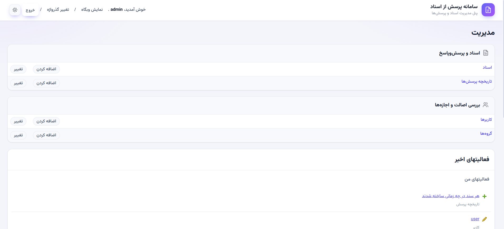
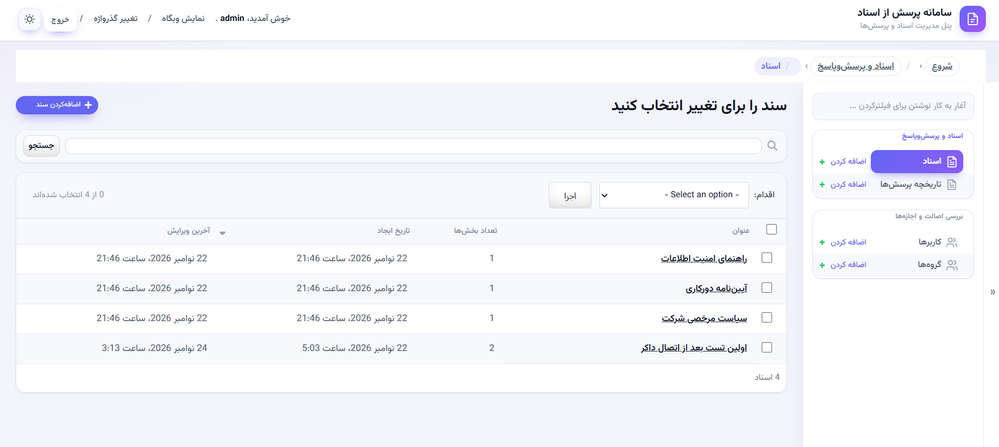
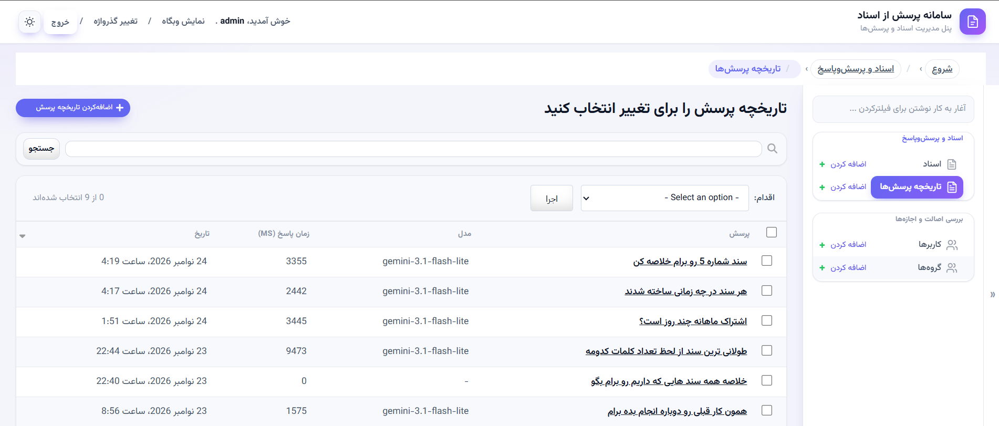
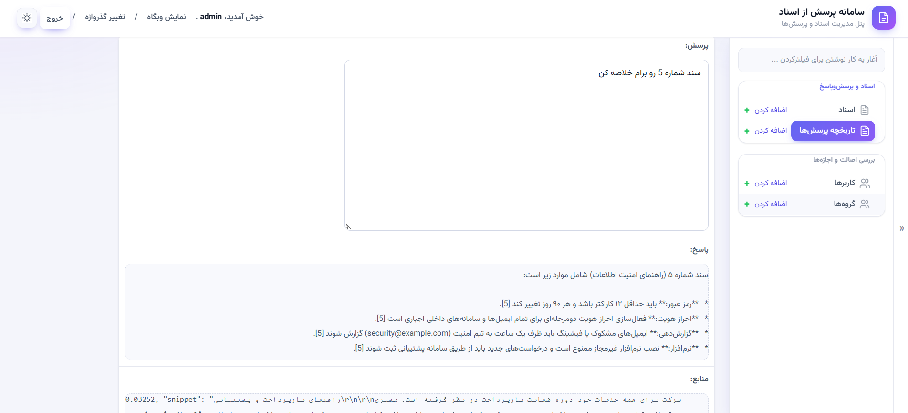

# سامانه پرسش از اسناد (Document Q&A)

سامانه‌ای برای ثبت اسناد متنی و پرسش و پاسخ بر پایه‌ی محتوای آن‌ها، با **Django**، **LangChain** و مدل زبانی **Gemini** (Google AI Studio). رابط کاربری با پنل ادمین Django پیاده‌سازی شده است.


## نمونه داده و اسکرین‌شات

- اسناد و پرسش‌های نمونه: پوشه‌ی [`sample_data/`](sample_data/)

### پنل مدیریت

| داشبورد | اسناد |
|---|---|
|  |  |

| تاریخچه پرسش‌ها | پاسخ و منابع |
|---|---|
|  |  |


## ویژگی‌ها

- افزودن، ویرایش و حذف اسناد؛ آپلود فایل `docx` یا وارد کردن متن
- ذخیره‌ی متن کامل سند و تقسیم خودکار آن به بخش‌های کوچک (chunk)
- بازیابی ترکیبی (BM25 + TF-IDF) با نرمال‌سازی متن فارسی، بدون نیاز به embedding
- تولید پاسخ بر اساس اسناد، همراه با منبع، امتیاز و زمان پاسخ
- ذخیره‌ی تاریخچه‌ی پرسش‌ها و پاسخ‌ها؛ با ویرایش یک پرسش، پاسخ همان رکورد دوباره ساخته می‌شود
- API کامل (DRF) با مستندات Swagger؛ جزئیات در [API.md](API.md)
- اجرا با Docker Compose (Oracle Database Free + Django)

## پیش‌نیازها

- Docker و Docker Compose
- یک کلید API رایگان از [Google AI Studio](https://aistudio.google.com/apikey)

## راه‌اندازی

```bash
cp .env.example .env
# مقدار OPENROUTER_API_KEY را در .env با کلید Google AI Studio پر کنید
docker compose up --build
```

اولین بار، بالا آمدن Oracle چند دقیقه طول می‌کشد؛ سرویس `web` صبر می‌کند تا دیتابیس آماده شود، سپس مایگریشن‌ها اجرا می‌شوند. اسناد نمونه‌ی پوشه‌ی `sample_data/` هنگام بالا آمدن بارگذاری می‌شوند (اسنادی که قبلاً ثبت شده‌اند رد می‌شوند).

| آدرس | توضیح |
|------|-------|
| http://localhost:8000/admin/ | پنل مدیریت (کاربر `admin`، رمز `admin12345`؛ فقط برای تست) |
| http://localhost:8000/api/docs/ | مستندات Swagger |
| http://localhost:8000/api/ | API |

توقف: `docker compose down` (داده‌ها حفظ می‌شوند). حذف کامل دیتابیس: `docker compose down -v`.

## نحوه استفاده

1. **اسناد**: در پنل ادمین، سند اضافه کنید (فایل docx یا متن). بخش‌ها به‌صورت خودکار ساخته می‌شوند.
2. **تاریخچه پرسش‌ها**: پرسش جدید اضافه کنید؛ با ذخیره، پاسخ و منابع ساخته می‌شود. ویرایش متن پرسش، پاسخ را دوباره تولید می‌کند.
3. **API**: از Swagger استفاده کنید (`Try it out`).

## معماری

```
docx / متن ──► Document ──► Chunk ──► DB
                               │
پرسش ──► HybridRetriever (BM25 + TF-IDF) ──► prompt ──► LLM (Gemini) ──► پاسخ + منابع
```

| فایل | نقش |
|------|-----|
| `documents/models.py` | مدل‌ها (Document، Chunk، QueryLog) |
| `documents/services/ingest.py` | استخراج متن docx و chunking |
| `documents/services/retrieval.py` | بازیابی ترکیبی |
| `documents/services/rag.py` | زنجیره‌ی LangChain (retriever ← prompt ← LLM ← parser) |
| `documents/views.py` | endpoint های API |
| `documents/admin.py` | پنل مدیریت |
| `config/settings.py` | تنظیمات، اتصال Oracle، تنظیمات LLM |

## API

| متد | مسیر | توضیح |
|-----|------|-------|
| GET / POST | `/api/documents/` | لیست و ایجاد سند |
| GET / PUT / PATCH / DELETE | `/api/documents/{id}/` | مشاهده، ویرایش، حذف سند |
| POST | `/api/search/` | یافتن بخش‌های مرتبط با پرسش |
| POST | `/api/ask/` | پرسش و پاسخ |
| GET | `/api/history/` | تاریخچه‌ی پرسش‌ها |
| GET / DELETE | `/api/history/{id}/` | مشاهده و حذف یک پرسش |

شناسه‌ها (id) از sequence دیتابیس Oracle می‌آیند؛ یکتا و صعودی‌اند ولی پیوسته بودنشان تضمین نمی‌شود. شناسه را از خروجی لیست بردارید.

## متغیرهای محیطی (`.env`)

| متغیر | توضیح | پیش‌فرض |
|-------|-------|---------|
| `OPENROUTER_API_KEY` | کلید API مدل زبانی (اینجا کلید Google AI Studio) | - |
| `OPENROUTER_BASE_URL` | آدرس endpoint سازگار با OpenAI | `https://generativelanguage.googleapis.com/v1beta/openai/` |
| `OPENROUTER_MODEL` | نام مدل | `gemini-3.1-flash-lite` |
| `API_REQUIRE_AUTH` | نیاز به ورود برای API | `false` |
| `RAG_TOP_K` / `RAG_CHUNK_SIZE` / `RAG_CHUNK_OVERLAP` | تنظیمات بازیابی | `4` / `800` / `120` |
| `RAG_QUERY_REWRITE` | بازنویسی پرسش با مدل (یک تماس اضافه) | `false` |

> نام متغیرها (`OPENROUTER_*`) به دلیل سازگاری باقی مانده است. چون از endpoint سازگار با OpenAI استفاده می‌شود، با تغییر آدرس و مدل، OpenRouter یا هر سرویس مشابه هم کار می‌کند.

## نمونه داده و اسکرین‌شات

- اسناد و پرسش‌های نمونه: پوشه‌ی [`sample_data/`](sample_data/)
- اسکرین‌شات پنل مدیریت: پوشه‌ی [`screenshots/`](screenshots/)

## محدودیت‌ها

- ایندکس بازیابی در حافظه ساخته می‌شود (برای حجم بسیار زیاد به vector DB نیاز است)
- فقط فرمت docx پشتیبانی می‌شود
- سهمیه‌ی رایگان Gemini محدود است (درخواست در دقیقه و در روز)

## عیب‌یابی

| خطا | علت و راه‌حل |
|-----|--------------|
| `ORA-12541` / اتصال به دیتابیس | Oracle هنوز آماده نیست؛ چند دقیقه صبر کنید یا `docker compose restart web` |
| `DPY-6003` | `NAME` باید به شکل `host:port/service` باشد |
| `[خطا] ... 429` | سقف سهمیه‌ی رایگان؛ چند ثانیه تا چند دقیقه صبر کنید |
| `[خطا] ... 503` | شلوغی موقت سرویس مدل؛ دوباره امتحان کنید |
| `[خطا] ... 401/403` | کلید API اشتباه یا تنظیم‌نشده است (`.env` را بررسی کنید) |
| `[خطا] ... 404` | نام مدل اشتباه است |

## لایسنس

MIT (فایل [LICENSE](LICENSE))